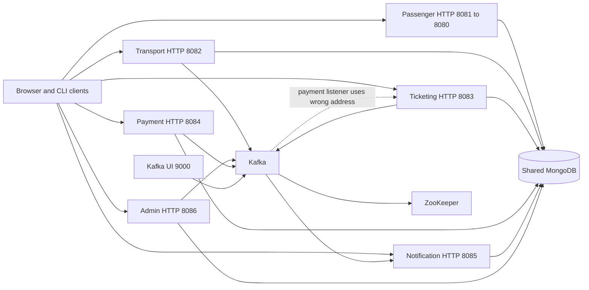

# Architecture and threat model

This model is derived from the repository. It describes the supplied Compose development topology; a separate production gateway or identity provider was not present in the reviewed files.

## Trust boundaries and authority

| Boundary | Present implementation | Required authority |
|---|---|---|
| Client to passenger service | HMAC JWT on seven resources; committed key; owner checks | Verified current principal, safe credential lifecycle, server-owned entitlements |
| Client to other services | Public HTTP with client/UI role conventions | Server authentication plus role/object/property policy |
| Service to MongoDB | Shared database with unauthenticated connection configuration | Least-privilege service identity, owned schemas, migration and integrity rules |
| Service to Kafka | Plaintext broker, no configured ACL identity | Authenticated producers/consumers, topic policy, validated versioned events |
| Mongo write to Kafka publication | Separate operations | Durable outbox/idempotent consumption and recovery |
| API data to browser DOM | Mixed escaped and raw HTML templates | Context-safe text/attribute rendering and restrictive serving policy |
| CLI data to shell/session storage | Eval strings and executable temp session files | Structured arguments, encoded JSON, private non-executable state |
| Repository to release | Locks exist but Docker omits them; no CI/SBOM | Reproducible reviewed artifacts and enforced validation gates |

All services share the same database and several write the same collections. The current design is therefore operationally distributed but tightly coupled through data. Fixing only HTTP contracts cannot establish ownership while two incompatible models continue writing `tickets`.

## End-to-end flow review

| Step | Current behavior | Consequence / finding |
|---|---|---|
| Register | Basic nonempty checks; SHA-256; returns profile only | Weak credential storage; Bash registration expects token — SEC-04, QA-04 |
| Login | Passenger issues one-hour JWT; admin returns identity JSON | Different client assumptions; absent staff session — SEC-01, UI-02, QA-04 |
| Discover | ObjectId-based transport lists; initial browser fetch not invoked | Loading never ends; identifiers/date/search adapters drift — UI-01–03 |
| Buy | Passenger writes one schema; ticketing writes another; browser uses absent endpoint | Different ownership/pricing/validity, no capacity reservation — DATA-01, DATA-09, UI-02 |
| Pay | Caller amount; random console/demo processing in an in-process task | No verified settlement; crash/idempotency gaps — SEC-03, DATA-07 |
| Activate | Kafka result updates by ticket ID; wrong consumer address | Lost processing or invalid state restoration — DATA-03, DATA-07 |
| Validate | PAID check then unconditional VALIDATED write | Multi-rides unusable; no atomic cross-instance consume — DATA-05 |
| Refund | Insert negative payment; original unchanged | Repeat refunds and stale entitlement — DATA-06 |
| Notify | Save and print; broadcasts share read status | Delivery is simulated, per-user receipts absent — DATA-08, DATA-11 |
| Report | Inconsistent date types and placeholder metrics | Missing/misleading totals and health — DATA-04, UI-09, OPS-06 |
| Logout/delete | Browser clears storage; delete removes user only | Copied tokens and linked data survive — SEC-10 |

The payment service is explicitly a simulator in README and source. No real gateway charging, webhook verification, or financial-provider compliance is claimed. Its API and state-management weaknesses still matter for demo correctness and for any evolution toward real payments.

## STRIDE threat cross-check

STRIDE is used here to check the architecture for omitted threat classes; OWASP ASVS remains the primary verification framework.

| Threat | Concrete path | Evidence |
|---|---|---|
| Spoofing | Forged passenger subject via known signing key; staff actions without verified actor | SEC-01, SEC-05 |
| Tampering | Caller sets PAID/price/rides, changes transport, or injects broker results | SEC-02–03, SEC-06 |
| Repudiation | Admin actor is a literal; browser audit history can be edited/cleared | SEC-08 |
| Information disclosure | Unprotected owner data, plaintext/weak credentials, raw HTML scripts, personal logs | SEC-01, SEC-04, SEC-08–09 |
| Denial of service | Unbounded reads/creation, no application quotas, single database/broker, serial resources | SEC-07, DATA-12, OPS-03–06 |
| Elevation of privilege | Public admin account/role operations and browser roles trusted as capabilities | SEC-01, UI-04 |

## Data and assurance boundaries

- Account identities, names, email, phone, and credential-derived material require explicit privacy/logging/retention rules.
- Tickets, payments, refunds, reservations, and validation history require integrity, idempotency, and recovery guarantees.
- Payment requests accept PAN/CVV-shaped details, but the service builds a separate payment record and does not explicitly persist those fields. No claim that stored payment records contain CVV is made.
- Public transport schedules and disruptions still need authenticated authorship and integrity, even when public reads are intended.
- External DNS, certificates, production hosting, gateway controls, backups outside the repository, organizational policy, asset rights, and real payment-provider obligations were unavailable for verification.
