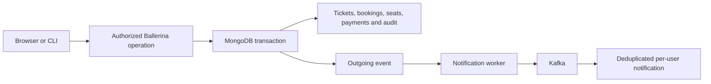

# Architecture and decisions

This guide accompanies the application repairs. `REMEDIATION.md` records implementation and verification separately; the original `audits/` reports remain a historical baseline, not a certification of this version.

## Purpose and boundaries

Urban Ticketing Hub is a university/demo application for finding trips, reserving seats, buying route-specific tickets, validating journeys, and managing transport. Payments are simulated; notifications are in-app. One machine is sufficient for the demo, but it is not a highly available production deployment.

## Decisions and tradeoffs

| Decision | Why and advantages | Drawbacks and alternatives |
|---|---|---|
| Keep six Ballerina services, MongoDB, Kafka, and plain browser JavaScript | Preserves the project's learning goals and capabilities; named functions and explicit records are easy to follow. | Six services require more setup than a monolith. A rewrite into another framework would add migration work without fixing the underlying rules. |
| Share a small Ballerina core library | Gives authentication, validation, database access, and error handling one implementation. | Services must rebuild when the library changes. Avoid a configurable framework or dependency-injection container. |
| Use Argon2id password hashes | Uses the language's maintained cryptography rather than homemade password hashing. | Deliberately consumes CPU and memory. Apply request limits; never log passwords or hashes. |
| Store hashes of random bearer sessions | Logout, expiry, and account deactivation take effect on the next request; no signing secret can forge identities. | Every authenticated request needs a database lookup. Self-contained JWTs avoid this read but make immediate revocation harder. |
| Keep tokens in tab-scoped session storage | Supports the browser and CLI with one explicit bearer interface and avoids ambient-cookie CSRF. | JavaScript can read a token if XSS occurs. Safe DOM construction, a restrictive CSP, short expiry, and logout remain necessary; this is a demo tradeoff, not an assertion that session storage defeats XSS. |
| Separate ticket entitlements from trip bookings | A ten-ride ticket is not ten seats on the same trip; bookings track seats and tickets track rights to travel. | Two related records must stay consistent. A transaction is clearer than repair scripts after partial writes. |
| Calculate prices and state on the server | Clients cannot grant themselves paid tickets, extra rides, or discounted fares. Integer minor units avoid floating-point money errors. | Clients must request current data rather than treat a cached fare as authoritative. |
| Use official MongoDB driver transactions through a thin Java adapter | The Ballerina MongoDB connector lacks the required session API. The adapter provides generic persistence operations; business rules stay in Ballerina. | Adds a Java build and requires a replica set. Optimistic version checks prevent stale reads from silently overwriting newer state. No distributed saga or custom database engine is needed. |
| Use a transactional outbox and event IDs | Database changes survive a crash before Kafka publication. Retrying an event is safe when consumption is deduplicated. | Delivery is at least once, not globally exactly once. A small retry worker and delivery status need maintenance. Kafka must not decide whether a ticket is paid. |
| Bound lists and add query-specific indexes | Predictable response sizes and index-supported filtering keep the demo usable as data grows. | Indexes consume disk and slow writes. Indexes must match actual queries rather than every possible field. |
| Use offset pagination for interactive lists | Default 20/max 100 rows and an offset ceiling of 10,000 keep previous/next controls and API calls easy to understand. | Skipping rows costs work and concurrent writes can shift page boundaries. Cursor pagination is better for large changing datasets; the event fanout worker already uses keyset pages where stable iteration matters. |
| Keep plain HTML, CSS, and JavaScript | Native forms, dialogs, modules, and DOM APIs are sufficient; fewer layers make debugging easier. | State and rendering conventions must be explicit. A frontend framework is unnecessary for these workflows. |
| Use native Ballerina tests, Python helper tests, and Playwright with axe | Each checks a different boundary: business rules, command helpers, and real browser journeys/accessibility. | Browser and database tests take longer than unit tests. Mock results cannot establish transaction or recovery guarantees. |
| Use an authenticated single-node replica set and Kafka KRaft | Supports transactions and removes the extra ZooKeeper service; only the local gateway needs a host port. | One node remains a single point of failure. Backups aid recovery but do not provide availability. Internal container networking is not encryption against a compromised host. |

## Business rules

All tickets belong to one passenger and one route. A single costs one base fare and covers one selected trip. A ten-ride pack costs eight fares, expires after 30 days, and consumes one ride per validated booking. A monthly pass costs twenty fares and permits unlimited bookings on that route for 30 days. One passenger cannot reserve the same trip twice. Purchase includes the first booking.

An unpaid reservation lasts ten minutes. Cancelling releases its seat and reserved ride. Validation is permitted once per booking, by an operator assigned to its trip or an authorized transport manager. A full refund is permitted once, before any ride is validated; it revokes the ticket and cancels its bookings. No partial or prorated refunds are provided.

Application IDs are UUID strings, timestamps are UTC ISO 8601, and amounts are NAD minor units. Database `_id` fields are internal. Lists default to 20 results and accept at most 100.

## Concepts in the implementation

Ticketing owns entitlement and booking transitions; Transport owns route and trip definitions. Seat-counter changes use the shared transactional functions, so capacity edits and bookings participate in the same version checks. Payment endpoints simulate outcomes and call those functions rather than maintaining a second ticket schema. Account/session functions are shared by the passenger and administrative endpoints; only the notification worker publishes and consumes events.

The ticketing service runs a separate expiry job, so Kafka outages cannot prevent unpaid seats being released. Account version guards serialize new bookings per passenger, including the 100-active-booking bound. Browser render generations reject late navigation responses. These are small local safeguards rather than additional coordination frameworks.

Confirmed bookings also expire when their validation window or ticket validity ends. Their reserved ride is released without counting it as a validated journey, so a missed trip cannot block a pack or account deletion forever. The expiry query uses inner joins to current trip/ticket dates instead of maintaining a second deadline that could become stale after rescheduling. Its work depends on the confirmed-booking count; each batch returns at most 100 rows and has a five-second query budget. This favors understandable, consistent behavior for the demo over an additional scheduling/index-maintenance subsystem.

Dependency scans also justify small derived infrastructure images: keep supported MongoDB 8.0, update the broker to Kafka 4.4.0, and replace only vulnerable bundled helper/OS libraries with verified versions. Advantages are narrow changes and retained upstream entrypoints; drawbacks are responsibility for rechecking compatibility and refreshing patches. All remote replacement artifacts have SHA-256 checksums. This is preferable to ignoring known advisories or rewriting vendor software.

The published gosu 1.20 binary still embeds Go 1.24.6. Its unchanged upstream source is therefore rebuilt with pinned Go 1.27.3 in a build-only stage. The application gains no Go service or custom privilege-switching code; the drawback is an extra toolchain download during the first infrastructure build.

**ACID:** atomicity commits every transaction write or none; consistency comes from business checks, unique indexes, and conditional updates; isolation uses MongoDB transactions plus version guards to reject stale state; durability uses majority write concern on the replica set. A one-node majority cannot survive loss of that node's storage. ACID does not make Kafka delivery part of a MongoDB transaction.

**OOP and encapsulation:** objects manage database/client lifecycle and the small Java adapter. Scheduled job classes implement the common `task:Job` interface, demonstrating interface-based polymorphism. Ballerina maps carry JSON documents and literal unions constrain roles/products; data shapes are not an inheritance hierarchy. Most business logic remains ordinary functions. No pattern is introduced solely to demonstrate a concept.

**Authorization:** the server derives identity from a live session, denies unknown roles, and checks both permission and record ownership. Browser visibility is a convenience, not an access-control boundary.

**Idempotency:** a unique operation key identifies a retry. A matching retry returns the original result; reusing the key for a different request is rejected. Consumer deduplication uses the event ID in the same transaction as the notification write.

## Joins and complexity

Comments identify actual joins where implemented. MongoDB `$lookup` normally has left-outer semantics; subsequent filtering can change the effective result. `$match` is selection, `$project` is projection, and `$group` is aggregation, not a join. Fetching a related record by ID is an indexed lookup. Combining two fetched collections with an ID map is an application-side association; retaining unmatched left records has left-outer semantics.

Complexity comments define their variables and assumptions. Fixed product pricing is O(1). A suitable database index gives approximately O(log N + k) traversal for `N` records and `k` matched/returned records; an unindexed scan is O(N). Offset pagination also pays for skipped records. The expiry join examines `c` confirmed candidates using indexed trip/ticket lookups, approximately O(c(log T + log K)). Refunds use O(b log T) trip lookups for at most 100 bookings. Broadcast fanout uses keyset pages and indexed recipient/delivery lookups. Network latency, document size, and transaction contention are separate from these operation counts. Query plans, not comments alone, verify index use. An in-memory hash lookup would be expected O(1), not a worst-case guarantee.

## Sources

- [MongoDB Java transactions](https://www.mongodb.com/docs/drivers/java/sync/current/crud/transactions/)
- [Ballerina MongoDB API](https://central.ballerina.io/ballerinax/mongodb/latest)
- [OWASP password storage guidance](https://cheatsheetseries.owasp.org/cheatsheets/Password_Storage_Cheat_Sheet.html)
- [Playwright accessibility testing](https://playwright.dev/docs/accessibility-testing)
- [NGINX dynamic upstream resolution](https://nginx.org/en/docs/http/ngx_http_upstream_module.html#server)
- [Apache Kafka releases](https://kafka.apache.org/community/downloads/)
- [gosu upstream source](https://github.com/tianon/gosu/tree/1.20)
